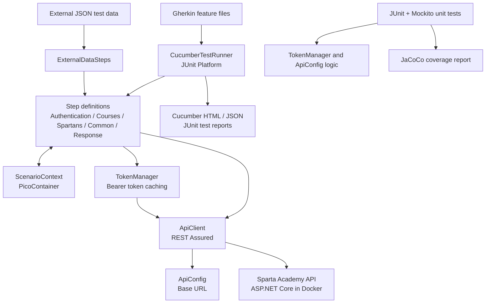
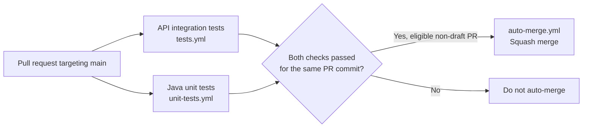

# Sparta Academy API Test Framework

A **Java 21 automated API testing framework** created for the Sparta Global API Test Framework project. It tests the supplied Sparta Academy REST API using **Cucumber/Gherkin**, **REST Assured** and **JUnit 5**, with **Mockito** unit tests, **JaCoCo** coverage reports and **GitHub Actions** continuous integration.

> **Scope:** This repository contains the automated **tests**, not the ASP.NET Core system under test (SUT). The API is supplied separately and runs in Docker.

## Project objectives

The framework is designed to:

- Verify the documented API across happy paths, sad paths, edge cases and security scenarios.
- Express requirements through readable Gherkin scenarios.
- Reuse HTTP request methods, authentication logic, assertions and shared scenario state.
- Run parameterised tests with inputs from external JSON files.
- Unit-test framework logic independently using JUnit and Mockito.
- Execute checks automatically for pull requests, with accessible reports.

## Technology stack

| Technology | Purpose |
| --- | --- |
| Java 21 / Maven | Language, build and dependencies |
| Cucumber 7 / Gherkin | Behaviour-driven scenarios |
| REST Assured 5 | HTTP requests and response validation |
| JUnit 5 | Test execution and assertions |
| Mockito | Mocking dependencies in isolated unit tests |
| PicoContainer | Sharing scenario context between step-definition classes |
| Jackson | Reading external JSON test data |
| JaCoCo | Java code coverage reporting |
| Docker / ASP.NET Core | Hosting the supplied API for testing |
| GitHub Actions | CI checks, report artifacts and conditional PR merging |

Exact dependency versions are listed in `pom.xml`.

## Architecture

The diagram represents the classes and flow in the current test framework. GitHub renders Mermaid diagrams automatically in Markdown.



**Execution flow:** The JUnit Platform discovers Cucumber feature files. Step definitions execute HTTP requests and assertions, with `ScenarioContext` sharing the current token, request and response. `TokenManager` obtains and caches bearer tokens; `ApiClient` uses REST Assured and the base URL configured by `ApiConfig` to communicate with the Docker-hosted API. `ExternalDataSteps` reads JSON input files. Unit tests run separately and produce JaCoCo metrics.

## Repository structure

```text
sparta-academy-api-tests/
├── .github/workflows/
│   ├── tests.yml                  # Docker API integration tests
│   ├── unit-tests.yml             # JUnit/Mockito and JaCoCo
│   └── auto-merge.yml             # Conditional squash merging
├── src/
│   ├── main/java/com/sparta/wzz/
│   │   ├── client/ApiClient.java
│   │   └── config/ApiConfig.java
│   └── test/
│       ├── java/com/sparta/wzz/
│       │   ├── auth/TokenManager.java
│       │   ├── context/ScenarioContext.java
│       │   ├── runners/CucumberTestRunner.java
│       │   ├── stepdefinitions/
│       │   └── unit/
│       └── resources/
│           ├── features/
│           ├── testdata/
│           └── junit-platform.properties
├── pom.xml
└── README.md
```

## Prerequisites and setup

Install **JDK 21**, **Maven**, **Git** and **Docker Desktop** (or an equivalent Docker environment). Verify installation:

```bash
java -version
mvn -version
docker --version
```

### 1. Start the system under test

Obtain the **supplied Sparta Academy API source or Docker image** from the assignment materials. The source code is maintained separately and is **not** included in this public repository.

If building from source, run these commands **inside the supplied `SpartaAcademyAPI` directory containing its Dockerfile**:

```bash
docker build -t spartaacademyapi .
docker run -d --name sparta-api -p 8080:8080 -e ASPNETCORE_URLS=http://+:8080 spartaacademyapi
```

If the Docker image is already supplied, skip the build and substitute its actual image name in `docker run`.

Confirm that the API starts by opening Swagger UI (`http://localhost:8080/swagger/index.html`) or Swagger JSON (`http://localhost:8080/swagger/v1/swagger.json`).

Useful diagnostics:

```bash
docker ps
docker logs sparta-api
```

To stop and remove the test container:

```bash
docker stop sparta-api
docker rm sparta-api
```

> **Data-safety warning:** The suite includes scenarios that change **seeded Spartan data**, including a successful DELETE of Spartan ID 2 and an update/restore scenario involving Spartan ID 21. Only run integration tests against an **isolated, disposable** SUT. Recreate a clean container when repeatability matters.

### 2. Clone the testing framework

```bash
git clone https://github.com/WenZhu72/sparta-academy-api-tests.git
cd sparta-academy-api-tests
```

## How to run the tests

Run Maven from the testing repository root, while the API is available on `http://localhost:8080`:

| Goal | Command |
| --- | --- |
| Run the normal Cucumber suite | `mvn -Dtest=CucumberTestRunner test` |
| Run Cucumber with full Maven verification/reports | `mvn -Dtest=CucumberTestRunner verify` |
| Run unit tests and generate JaCoCo report | `mvn -Dtest=TokenManagerTest,ApiConfigTest verify` |
| Override the API base URL | `mvn -Dtest=CucumberTestRunner -Dapi.base.url=http://localhost:8080 verify` |
| Run security scenarios | `mvn -Dtest=CucumberTestRunner "-Dcucumber.filter.tags=@Security" test` |
| Run known-defect scenarios separately | `mvn -Dtest=CucumberTestRunner "-Dcucumber.filter.tags=@defect" test` |

The default `junit-platform.properties` contains `cucumber.filter.tags=not @defect`. Therefore, the standard suite **excludes known-defect scenarios**. Running tagged defects separately can produce expected test failures until the SUT is fixed.

`ApiConfig` defaults to `http://localhost:8080`; use `-Dapi.base.url=...` for another environment. `TokenManager` optionally reads `API_USERNAME` and `API_PASSWORD` environment variables; without them it uses the supplied SUT's sample credentials. Never commit production credentials or bearer tokens.

## Test strategy

Feature files in `src/test/resources/features` cover authentication, courses, Spartan CRUD, security, validation, boundary cases, response structures, external data and seeded-record integrity.

Common tags include `@HappyPath`, `@SadPath`, `@Boundary`, `@Security` and `@defect`. The last tag preserves known API discrepancies for later regression testing without blocking ordinary CI runs.

External JSON inputs are stored in `src/test/resources/testdata/spartan-invalid-names.json`. Unit tests are located in `src/test/java/com/sparta/wzz/unit/`.

## Reports and code coverage

| Output | Local path |
| --- | --- |
| Cucumber HTML | `target/cucumber-reports/cucumber.html` |
| Cucumber JSON | `target/cucumber-reports/cucumber.json` |
| JUnit/Surefire results | `target/surefire-reports/` |
| JaCoCo HTML | `target/site/jacoco/index.html` |
| JaCoCo CSV | `target/site/jacoco/jacoco.csv` |

GitHub Actions uploads the `cucumber-test-results` and `jacoco-report` artifacts. Download them from the relevant run on the Actions page.

**Coverage-report limitation:** Standard JaCoCo reporting analyses compiled production classes in `src/main/java`. Here, `TokenManager` is under `src/test/java`, so its executed unit-test logic is not represented in the default coverage totals. JaCoCo code coverage is also not equivalent to API endpoint or scenario coverage.

## Continuous integration



- **API integration workflow:** Triggers on pull requests and pushes to `main`/`dev` and supports manual dispatch. It checks out the Java tests and a **separate private API source repository**, builds the API Docker image, waits for Swagger readiness, runs the Gherkin suite and uploads Cucumber/JUnit reports. Cross-repository checkout requires the `SPARTA_API_READ_TOKEN` repository secret with permission to read the private SUT repository.
- **Java unit-test workflow:** Runs `TokenManagerTest` and `ApiConfigTest`, generating and uploading JaCoCo coverage.
- **Automatic merge workflow:** Verifies that both required workflows succeeded for the current PR commit, then attempts a squash merge only for eligible, mergeable, non-draft pull requests from this repository into `main`. Missing or failing checks prevent this merge attempt.

> **Review warning:** Eligible pull requests can be merged without a separate manual review. Use a **draft pull request** while preparing changes you do not want merged yet.

## Contribution guidelines

1. Create a branch and identify the relevant GitHub Issue/user story.
2. Write or adjust the applicable Gherkin feature scenario.
3. Reuse `ApiClient`, `ScenarioContext`, `CommonSteps` and `ResponseSteps` instead of duplicating behaviour.
4. Add resource-specific logic to the appropriate step-definition class and test data to `src/test/resources/testdata/`.
5. Add or update JUnit/Mockito unit tests when introducing framework logic.
6. Use meaningful tags and avoid test dependencies on persistent seeded state.
7. Run the relevant tests on a disposable API container and review the generated reports.
8. Create a GitHub Issue for each verified SUT defect, linking reproduction evidence and the relevant tests.
9. Open a pull request. CI runs automatically, and **non-draft eligible PRs may auto-merge** after checks pass.

Never commit API tokens, credentials or generated `target/` build artifacts.

Testing ci/cd